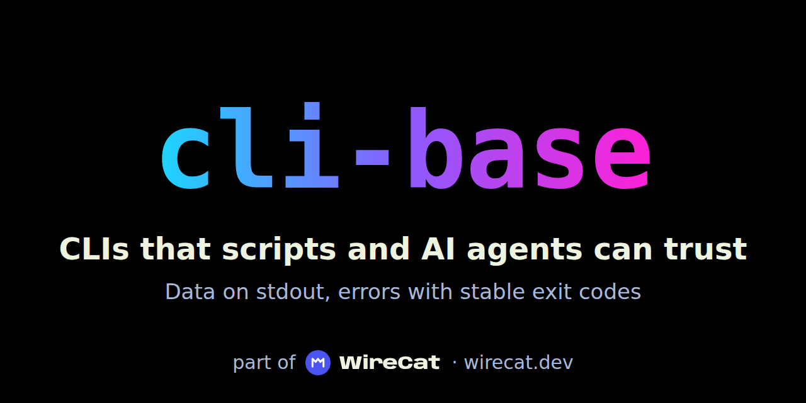
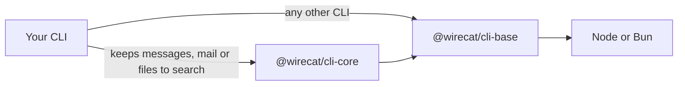

<p align="center">
  
</p>

# @wirecat/cli-base

Build a command-line tool that a script and an AI agent can trust, in TypeScript on Node or Bun. cli-base keeps data
on stdout and everything else on stderr, and turns every failure into one JSON error with a stable exit code.

```ts
import { CliError, captureStreams, createRenderer, errorObjectOf, exitCodeOfError, renderError } from "@wirecat/cli-base"

const streams = captureStreams()
createRenderer({ format: "json", color: false, streams }).result({ chats: 2 })

const error = errorObjectOf(new CliError("not_found", "No chat named Alice"))
streams.diagnostic(renderError(error, { cli: "acme", interactive: false }))

streams.stdout // ['{"chats":2}']
streams.stderr // ['{"error":{"code":"not_found","reason":"item.not-found","message":"No chat named Alice","retry":{"safe":false}}}']
exitCodeOfError(error) // 6
```

No spinner, no `✓` and no warning ever reaches stdout in a machine mode, so `acme chats --json | jq` always gets clean
JSON. `captureStreams` lets a test prove it.

**Built on it:** [cli-core](https://github.com/WireCatLabs/cli-core) and 15 WireCat CLIs on top of it, among them
[tg-cli](https://github.com/WireCatLabs/tg-cli), [max-cli](https://github.com/WireCatLabs/max-cli) and
[gcal-cli](https://github.com/WireCatLabs/gcal-cli). [cli-testing](https://github.com/WireCatLabs/cli-testing) uses
it alone.

## Install

```sh
npm install @wirecat/cli-base
```

It is ESM only, for Node 22 and later, and runs on Bun. `import` it (`require()` works from Node 22.12). Add
`commander` if you use `/skill`, and `vitest` if you use `/testing/setup`.

**What semver covers.** The entry points listed under `wirecat.stable` in `package.json` are the stable API: from
1.0.0 on, a break there waits for a major and is deprecated first. A name inside one of them that carries the TSDoc
tag `@experimental` is not covered, and neither is any entry point missing from the list (`/codegen`, `/release`,
`/testing`, `/testing/setup`, the config files) or the `cli-dev` commands. Those may change in a minor, under the
changelog heading "Changed — experimental" ([WC-REL-7](docs/standards/releases.md)).

[API reference](docs/REFERENCE.md) · [Architecture](docs/dev/ARCHITECTURE.md) · [Shared tooling](docs/TOOLING.md) ·
[Standards handbook](docs/standards/README.md) · [Changelog](CHANGELOG.md) · [wirecat.dev](https://wirecat.dev)

[](https://www.npmjs.com/package/@wirecat/cli-base)
[](https://github.com/WireCatLabs/cli-base/actions/workflows/ci.yml)
[](https://nodejs.org/)
[](https://bun.sh/)
[](LICENSE)

## Which package to install



Install [cli-core](https://github.com/WireCatLabs/cli-core) when your tool keeps what it reads in a local store and
searches it. It brings cli-base along as a peer. For any other CLI, cli-base alone is enough.

## Features

- **A script branches on `$?`, an agent on one JSON object.** 15 closed error codes, each with its own exit number:
  2 for a bad argument, 4 for a failed sign-in, 6 for not found. Errors are recognised by a brand, not a class, so two
  installed copies of the package still understand each other's errors.
- **Output that never stops halfway.** `pretty` for a person, `json` or `jsonl` for a program, and `--json=id,name`
  for only those fields. Output waits until the command succeeds, and past 4 MiB it fails with an error instead of
  cutting the answer.
- **Tests that never wait.** The clock, the sleep, the keyring, `env`, `fetch` and the streams are arguments. A
  timeout test finishes at once, a retry test needs no real backoff, and a keyring test cannot reach a real keychain.
  `/testing` has the fakes.
- **Retries that never send twice.** Backoff with full jitter, and "no answer came" is never read as "safe to repeat".
  A write whose outcome is unknown stays unknown and is not retried.
- **The command tree as data for an agent.** `commands --json` gives every command, option and default instead of
  `--help`. `cli-dev lint` checks the tree against the shared vocabulary, and `cli-dev audit` compares several CLIs.
- **One query language for every list.** `tasks list state:open priority>1` is parsed by a port of the Lucene
  9.12.3 parser, with the fields read from the entity's own schema. An unknown field fails with the list of fields
  that exist.
- **API clients that never guess.** `/codegen` turns an OpenAPI 3.0 or 3.1 document into types, Valibot schemas and an
  operation manifest. It stops on an operation it cannot classify as a read, a write or a delete, and never falls back
  to `any`.
- **Installs that stay current, and never update unasked.** The CLI knows which package manager installed it and
  prints the command that updates it. `wcat tg …` runs `wcat-tg …`, so every WireCat tool is one command away.

### Secrets in the OS keyring, on every platform

Credentials resolve environment, then keyring, then file. When the keyring refuses, it warns once and falls through.

| Platform | Backing store | Needs installing |
|---|---|---|
| macOS | Keychain, via the Security framework | nothing, part of the OS |
| Windows | Credential Manager | nothing, part of the OS |
| Linux desktop (GNOME, KDE) | Secret Service over D-Bus: `gnome-keyring`, `kwallet` | nothing on a normal desktop, the keyring must be **unlocked** |
| Linux headless, container, WSL, CI | usually **nothing**: no session bus, no secrets daemon | falls back to a `0600` file, with one warning on stderr |
| FreeBSD | Secret Service, same as Linux | same |

No compiler is involved. Prebuilt binaries cover twelve platform triples, and the Linux one speaks D-Bus itself, so
libsecret is not needed. Checked against `@napi-rs/keyring` 2.1.0 on 2026-09-19. Two traps to design for, a shared
entry in a throwaway config folder and a locked Linux keyring, are in the
[API reference](docs/REFERENCE.md#where-secrets-actually-go-per-platform).

## Development

```sh
pnpm test        # vitest, Node
pnpm smoke:bun   # the same exports, run under Bun
pnpm lint
pnpm typecheck
pnpm build
```

Four runtime dependencies: valibot and its JSON Schema converter, cli-table3 and cross-spawn. A CLI takes its
TypeScript, Biome, lefthook, CSpell and CI setup from here, one piece at a time ([Shared tooling](docs/TOOLING.md)),
and `cli-dev` replaces the scripts every CLI used to copy. Which checks run on which platform is in
[Testing](docs/dev/TESTING.md#platforms).

## Releasing

`bin/release` on `main` starts [`release.yml`](.github/workflows/release.yml), which runs every check and publishes
through npm's [trusted publishing](https://docs.npmjs.com/trusted-publishers/) with provenance, with no npm token in
GitHub. It tags `v<version>` once npm shows the new version. The steps are in [RELEASING.md](docs/dev/RELEASING.md),
and how a release reaches the tools is in the
[architecture](docs/dev/ARCHITECTURE.md#how-a-change-is-published-and-picked-up).

## Key documents

| Document | What it answers |
|---|---|
| [Architecture](docs/dev/ARCHITECTURE.md) | The entry points, the lines this package does not cross, who consumes what |
| [API reference](docs/REFERENCE.md) | What each entry point holds, with examples |
| [Shared tooling](docs/TOOLING.md) | The TypeScript, Biome, lefthook, docs and CI setup a CLI takes from here, and `cli-dev` |
| [Publishing](docs/PUBLISHING.md) | Where a CLI is published beyond npm, how to prove it, and what has gone wrong |
| [Testing](docs/dev/TESTING.md) | The checks, and what each one is for |
| [Conventions](docs/dev/CONVENTIONS.md) | How code here is written |
| [Standards handbook](docs/standards/README.md) | The rules every WireCat CLI follows, one page per area and a new-CLI checklist |
| [CLI standard](https://github.com/WireCatLabs/cli-core/blob/main/docs/dev/STANDARD.md) | The messenger rules for tg, max and wa |
| [Roadmap](docs/roadmap.md) | What is being built next for developers on this package |
| [Changelog](CHANGELOG.md) | What each version changed, and what may break callers |

## History

Up to version 0.20.0 (October 2026) this package was `@wirecat/cli-core`. That name now belongs to the shared
messaging engine, so in older changelogs, plans and issues "cli-core" means this package. Those old `@wirecat/cli-core`
versions (0.18 to 0.20) are deprecated on npm.

## Licence

[Apache License 2.0](LICENSE).
